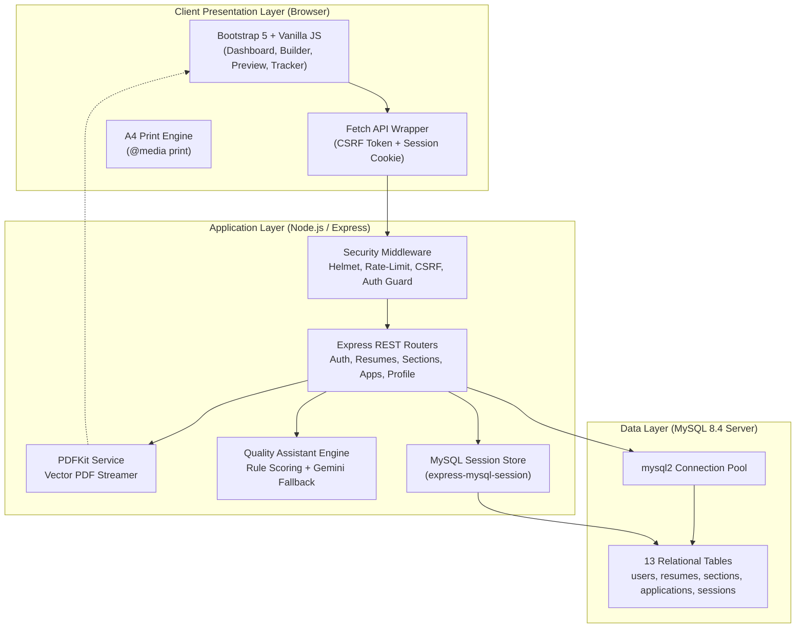
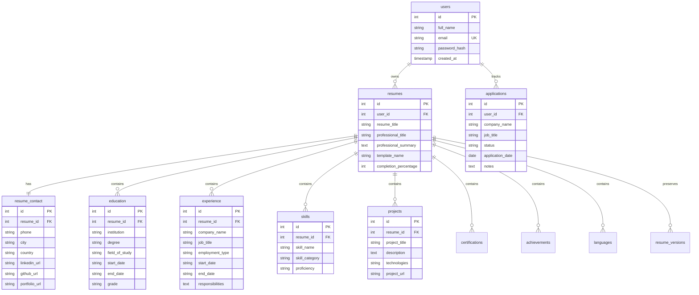

# ResumeCraft — AI-Powered Resume Builder and Career Assistant

> **College Web Technologies Project | Full-Stack Engineering Showcase**  
> **Author:** Gayathri Budarpu  
> **Application URL:** [http://localhost:3000](http://localhost:3000)  
> **Repository:** `/Users/bgayathri/.gemini/antigravity/scratch/resumecraft`

---

## 1. Project Overview & Problem Statement

### Problem Statement
> *“Helps individuals create professional resumes and improve their access to employment opportunities.”*

Job seekers, university students, and fresh graduates frequently encounter obstacles when transitioning from academia to the corporate workforce. Modern organizations rely heavily on **Applicant Tracking Systems (ATS)** that automatically parse and filter applicant resumes before human recruiters ever inspect them. Traditional word-processing documents often suffer from formatting anomalies, unparseable multi-column layouts, passive phraseology, and misaligned skill keywords.

### Solution: ResumeCraft
**ResumeCraft** is a complete, database-connected, full-stack web application that empowers candidates to:
1. **Build multiple independent resumes** using guided, step-by-step collapsible forms.
2. **Switch dynamically across four recruiter-approved templates** (Modern, Professional, Minimal, and ATS-Friendly) without losing content.
3. **Persist every record in a normalized MySQL relational schema** with atomic transactions.
4. **Evaluate resumes with a built-in Quality Assistant** that scores quantifiable accomplishments, detects passive verbs, and computes keyword alignment against pasted job postings.
5. **Generate vector A4 PDFs** via server-side PDFKit and browser-optimized print stylesheets.
6. **Track job applications** from Saved to Applied, Interview, Offer, and Rejected.

---

## 2. Technology Stack

ResumeCraft intentionally uses clean, standards-compliant web technologies rather than heavy client frameworks like React or Angular, ensuring the architecture is transparent, maintainable, and straightforward to defend during a college viva examination.

### Frontend
- **HTML5 & Semantic Elements:** Accessible, clean semantic structure.
- **CSS3 & Design System:** Custom corporate palette (Deep Navy `#0f172a`, Royal Blue `#2563eb`, Sky Accent `#e0f2fe`), cards, status badges, and print-specific `@media print` rules.
- **Vanilla JavaScript (ES6+):** Fetch API, DOM manipulation, debounced input handlers, dynamic CSRF token management.
- **Bootstrap 5 & Bootstrap Icons:** Mobile-responsive grid, modals, dropdowns, and vector icons.

### Backend
- **Node.js (v24+):** High-throughput, event-driven runtime environment.
- **Express.js (v4.21+):** Modular routing, security middleware, and RESTful API endpoints.
- **Session-Based Authentication:** `express-session` with persistent MySQL storage via `express-mysql-session`.
- **Security & Integrity:** `bcryptjs` password hashing, `express-rate-limit` brute-force defense, `helmet` Content Security Policy, and CSRF token protection.
- **PDF Generation Engine:** `pdfkit` for high-resolution vector A4 PDF streaming.

### Database
- **MySQL Community Server (8.4):** InnoDB storage engine, normalized tables, foreign keys with `ON DELETE CASCADE`, composite indexing, and transactional isolation.
- **`mysql2/promise`:** Connection pooling, prepared statements, and async/await transactions.

### AI & Assistant Engine
- **Rule-Based Deterministic Assistant:** 100% offline-ready, scoring resumes on impact verbs, brevity, metrics, and job description token overlap.
- **Optional Google Gemini API:** Pluggable cloud enhancement for professional summaries and bullet point rewrites when `GEMINI_API_KEY` is configured.

---

## 3. System Architecture



---

## 4. Database Schema & Relationships

The database `resumecraft_db` consists of **13 normalized tables** designed according to third normal form (3NF) principles:



---

## 5. Software Prerequisites

Ensure you have the following installed on your machine:
- **Node.js:** v18.0.0 or later (v24.21.0 recommended)
- **npm:** v9.0.0 or later
- **MySQL:** v8.0 or v8.4 Community Server
- Modern web browser (Chrome, Safari, Edge, Firefox)

---

## 6. Installation & Execution Guide

### Step 1: Clone or Navigate to the Workspace
```bash
cd /Users/bgayathri/.gemini/antigravity/scratch/resumecraft
```

### Step 2: Install NPM Dependencies
```bash
npm install
```

### Step 3: Configure Environment Variables
Copy `.env.example` to `.env`:
```bash
cp .env.example .env
```
Ensure `.env` matches your MySQL configuration:
```ini
PORT=3000
NODE_ENV=development

# MySQL Configuration
DB_HOST=127.0.0.1
DB_PORT=3307
DB_USER=root
DB_PASSWORD=
DB_NAME=resumecraft_db

# Session Secret
SESSION_SECRET=resumecraft_college_project_secret_key_2026_xyz

# Optional: Google Gemini AI API Key (leave blank for local rule-based engine)
GEMINI_API_KEY=
GEMINI_MODEL=gemini-1.5-flash
```

*(Note: On systems running MySQL on default port 3306, set `DB_PORT=3306`.)*

### Step 4: Initialize MySQL Database
Run the database migration script to generate `resumecraft_db` and all 13 tables:
```bash
npm run init-db
```

### Step 5: (Optional) Seed Sample Demonstration Data
To populate the database with a full student software engineering resume and job applications:
```bash
npm run seed
```
Demo Credentials:
- **Email:** `demo@resumecraft.com`
- **Password:** `Demo@123`

### Step 6: Start the Application Server
```bash
npm start
```
Or for auto-reload during development:
```bash
npm run dev
```

### Step 7: Open in Browser
Open your browser and navigate to:
**`http://localhost:3000`**

---

## 7. Testing & Verification

Run the automated test suite covering 40 test assertions across authentication, validation, session security, resume CRUD, multi-table transactions, PDF generation, assistant scoring, and cross-user data isolation:

```bash
npm test
```

### Verified Test Assertions (40/40 Passing):
1. MySQL connection pool initialization & table schema discovery
2. Health (`GET /api/health`) & DB test (`GET /api/db-test`) verification
3. CSRF token generation (`GET /api/auth/csrf-token`)
4. Password mismatch rejection on registration
5. Secure user registration with bcrypt salted password hashing
6. Duplicate email registration rejection (HTTP 400)
7. Session state validation (`GET /api/auth/me`)
8. Session destruction on logout (`POST /api/auth/logout`)
9. 401 Unauthorized guard on protected routes
10. Password rejection for invalid credentials
11. Secure login establishing persistent MySQL session
12. Profile view & name updating (`PUT /api/profile`)
13. Resume creation (`POST /api/resumes`)
14. Contact info updating (`PUT /api/resumes/:id/contact`)
15. Education section CRUD (`POST /api/resumes/:id/education`)
16. Experience section CRUD (`POST /api/resumes/:id/experience`)
17. Skills section CRUD (`POST /api/resumes/:id/skills`)
18. Projects section CRUD (`POST /api/resumes/:id/projects`)
19. Relational resume querying with calculated completion percentage
20. Multi-table atomic resume duplication via MySQL transaction
21. Vector PDF generation (`GET /api/resumes/:id/pdf`) with correct headers
22. Resume Quality Score computation (0-100) across 4 rubrics
23. Job Description keyword alignment matching
24. Assistant suggestion generation with offline fallback
25. Job application tracker creation, filtering, and updating
26. Cross-user resume access isolation (prevents horizontal privilege escalation)
27. Cross-user deletion prevention
28. Cascading account deletion (`DELETE /api/profile`)

---

## 8. College Viva Voce Defense Guide

| Viva Question | Technical Architecture & Implementation in ResumeCraft |
|---|---|
| **Why Session Auth instead of JWT?** | Persistent sessions stored in MySQL (`express-mysql-session`) allow instantaneous server-side revocation on logout or account deletion. HttpOnly and SameSite cookie policies prevent XSS token theft, unlike `localStorage` JWTs. |
| **Why 13 Normalized Tables vs 1 JSON blob?** | Normalized 3NF schema provides ACID transaction consistency, cascading deletions (`ON DELETE CASCADE`), index optimizations, and atomic updates to individual sections without rewriting megabytes of unstructured JSON. |
| **How does CSRF Defense operate?** | Middleware (`middleware/csrf.js`) issues a cryptographically secure token stored in the session. All state-changing requests (`POST`, `PUT`, `DELETE`) require the `X-CSRF-Token` header, which cross-origin attackers cannot forge due to browser SOP. |
| **How does Brute Force Defense work?** | `express-rate-limit` enforces a threshold of 20 requests per 15 minutes per IP address on login and registration endpoints, responding with HTTP 429 when breached. |
| **What makes the ATS template parseable?** | Uses a strictly linear single-column structure, standard semantic headers (EDUCATION, EXPERIENCE, SKILLS), black-and-white high contrast, system fonts, and standard bullet characters without complex graphics. |
| **How does the Offline Assistant operate?** | Employs deterministic regex heuristics and a dictionary of 60+ action verbs and tech keywords. When `GEMINI_API_KEY` is present, cloud AI is enabled; otherwise, the system transparently utilizes the local rule engine without fabricated responses. |

---

## 9. Live Examination Verification Endpoints

During project demonstration, examiners can verify system health and database tables directly:
- **System Health:** `http://localhost:3000/api/health`
- **Database Test:** `http://localhost:3000/api/db-test`
- **CSRF Token:** `http://localhost:3000/api/auth/csrf-token`
- **Demo Resume PDF:** `http://localhost:3000/api/resumes/1/pdf`

---

## 10. Future Enhancements
- Integration of OAuth 2.0 (Google / GitHub Social Login).
- Collaborative resume review with shareable public links.
- Multi-language resume export (Spanish, German, Hindi).
- Cover letter generator linked to specific job application entries.

---
&copy; 2026 ResumeCraft &bull; College Web Technologies Project by **Gayathri Budarpu**.
